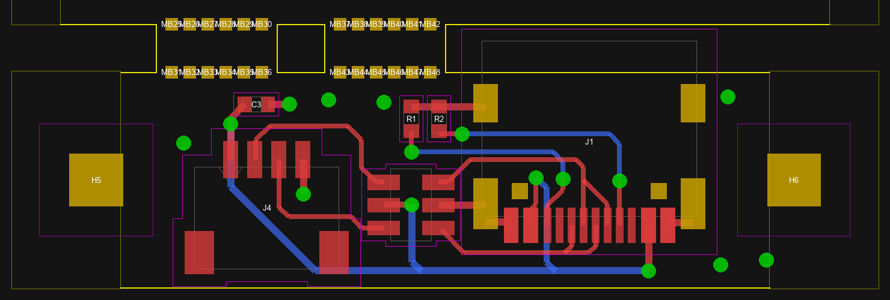
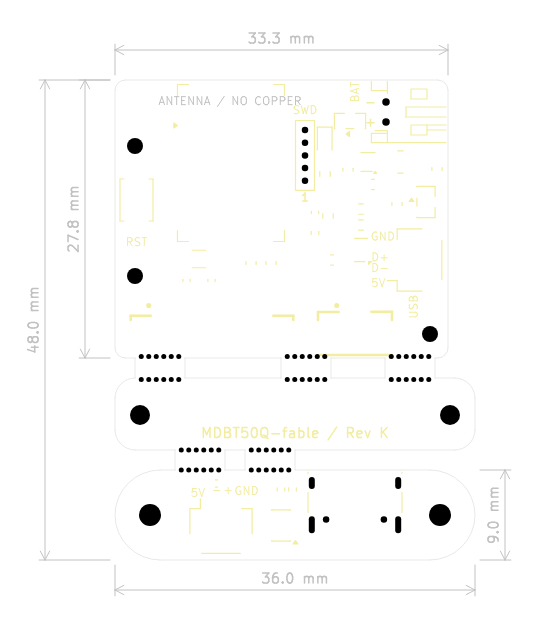
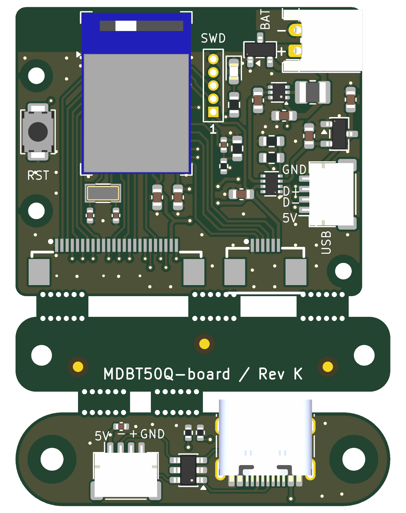

# MDBT50Q-board-fable — 変更点

`MDBT50Q-board-cdx`（Rev F）をコピーして作成した小型・本番向け版です。
元フォルダーのファイルは一切変更していません。KiCad 10 で `MDBT50Q-board.kicad_pro` を開いてください。

- **Rev K（2026-11-22）**：**USB基板の配線を 45° の曲がりだけで引き直しました**（直角の曲がり・直角の分岐をなくしました）。MCU基板の分岐 1 か所（SYS_3V3、C1 の上）も 45° に。シルクは、KiCad で手直しされたもの（20:41 保存）をスクリプトに取り込みました。回路・部品・配置は Rev J と同じです。Rev J のファイルは保存していません（Rev K で上書き。違いは配線の形だけです）。
- Rev J（2026-11-22）：逆接続保護 FET の Q1 を **Vishay Si2329DS-T1-GE3（LCSC C85167）** に変更。電池1本（単4×1）への対応に向けた変更です。**電池が減ったときの起動の下限は、実機で確認が必要です**（保証はできません）。電池2本はそのまま使えます。1本で使うには、別途、1本用の電池ホルダー（電池基板）と、本数に合わせたファームウェアの設定が必要です。基板の配置・配線は Rev I と同じ（フットプリント・ピン配置が同じ）。
- Rev I（2026-11-22）：電源まわりの配置を見直し。USB 用 LDO の U3 を入力 C6・出力 C7 のすぐ隣へ（U3–C7 中心間 12.9 → 2.9 mm、出力のビアなし）。昇圧の入力 C9 を U4/L1 のすぐ下へ（U4–C9 6.9 → 2.3 mm）。固定穴 H3 を右下角へ。幅は 33.3 mm のまま。Rev H のファイルは保存していません（Rev I で上書き。Rev H と Rev I の違いは電源まわりの配置だけです）。
- Rev H（2026-11-22）：MCU基板を **1.6 mm 狭く（33.3 × 27.8 mm）**。リセットスイッチ SW1 は元の TS-1088 のまま（小型品 KXT311LHS を試したうえで戻しました）。配線の曲がりを **すべて 45°**（直角の曲がりなし）に。Rev G のファイル一式は `archive/revG/` に残しています。
- Rev G（2026-11-22）：電池基板（`battery-board/`）のコネクタ J9 も **JST PH 2P（S2B-PH-K）** に変更。J9–J8 のケーブルは PH ↔ PH になりました。MCU基板・USB基板は Rev F から変更なし。Rev F のファイル一式は `archive/revF/` に残しています。
- Rev F（2026-11-22）：MCU基板の電池コネクタ J8 を JST SH から **JST PH 2P（S2B-PH-K、cdx の J5 と同じ横型スルーホール）** に戻し、**右辺の上端**に移しました。MCU基板は幅 +1.8 mm（34.9 × 27.8 mm）。
- Rev E（2026-11-21）：電池基板をこの PCB（パネル）から外し、MCU基板と USB基板だけにしました。電池基板はキーボード基板と一緒に製造します。回路図には電池基板の部品を残しています（基板・BOM・CPL からは除外）。電池基板のレイアウトは `battery-board/` に単独の PCB として残しています。ファイル一式は `archive/revE/` に残しています。
- Rev D（2026-11-21）：電池基板に単4電池2本を直列（縦一列）で載せるように変更。電池コネクタ J5 をやめ、JLCPCB の SMD 電池クリップ C6937104（−）／C6937107（+）を2個ずつ実装。ファイル一式は `archive/revD/` に残しています。
- Rev C（2026-11-21）：電池まわり（J5/F1/SW2）を別の電池基板に分離し、MCU基板とは JST SH 2P のケーブルで接続。MCU基板は 33.1 × 27.8 mm に縮小。Rev C のファイルは保存していません（Rev D で上書き）。
- Rev B（2026-11-21）：MCU基板をさらに小型化し、固定穴を M1.4 に変更。ファイル一式は `archive/revB/` に残しています。
- Rev A（2026-11-16）：初版。ファイル一式は `archive/revA/` に残しています。

## Rev K：USB基板の配線を 45° に



- USB基板の配線は cdx から引き継いだままで、直角の曲がりが 13 か所、直角の分岐（T 字・V 字）が 4 か所、重なった線や行き止まりの短い線がありました。Rev H の 45° 化は MCU基板だけが対象だったためです。
- 接続（どのピンとどのピンを、どの層・ビアでつなぐか）と線幅は変えずに、形だけを 45° の曲がりで引き直しました（`tools/finish.py` の `USB_ROUTES` と `usb_route()`）。GND の短い線とビアはそのままです。
  - D+：J1 の B6・A6 をコネクタのピン列の下でまとめ、U2-1 へ。分岐は 45°。
  - D−：J1 の B7 を A7 からの線へ 45° で合流させ、ピン列の上を通って U2-3 へ。
  - U2 → J4 の D−・D+、CC1・CC2（裏面経由で R2・R1 へ）、VBUS の裏面の線も、曲がりをすべて 45° に。VBUS の裏面の分岐 2 か所は 45° で合流させています。J4-1 側の斜めの線も、45° ちょうどにしました（Rev J は約 49°）。
- MCU基板：SYS_3V3 で、U1-28 と U1-30 からの線が C1 の上で直角（V 字）に合流していました。U1-30 からの線を少し下まで伸ばし、C1 への線に 45° で合流させました（`tools/finish.py` の `fix_joins()`）。
- 確認用スクリプト `tools/corners.py` を、パネル全体（MCU基板・USB基板）を調べ、直角の分岐（T 字・V 字）も数えるように変えました。電池基板も 0 です。
- 結果：直角の曲がり・直角の分岐 0、DRC 0、未配線 0、回路図との不一致 0、ERC 0。

### シルク（KiCad での手直しを取り込み）

最初の Rev K の作り直しで、KiCad で手直し・保存されたシルクを上書きして消してしまいました（`tools/run.py` は、cdx の基板から配置・配線・シルクまで毎回作り直して `MDBT50Q-board-fable.kicad_pcb` に上書きするためです）。保存されたファイルは KiCad のローカル履歴（`.history`、20:41:09 の「PCB Save」）に残っていたので、そのシルクを `tools/finish.py` の `silk()` に取り込み、作り直しても消えないようにしました。

- 表面：
  - `RST`・`SWD` の位置と大きさ（0.8 mm）。
  - J8 の横に `BAT`、J2 の横に `USB`（縦書き）と `GND` `D+` `D-` `5V`。
  - USB基板の J4 の上に `5V` `-` `+` `GND`。
  - 表面の `J6` `J7` は削除（裏面の `J6` `J7` は残す）。
- 裏面：ピン表を `BAT: 1=BAT+ 2=GND` と `USB: 1=5V 2=D-` / `3=D+ 4=GND` に。
- 取り込み後のシルクは、保存されたものと比べて、版数の文字（Rev J → Rev K）以外は同じです。
- 保存されたファイルそのものは `archive/revJ-user-silk/MDBT50Q-board-fable.kicad_pcb` に残しています。
- **注意**：今後も、基板・回路図はスクリプトで作り直します（`tools/run.py`・`tools/sch_update.py`）。KiCad で直接直した部分は、スクリプトに取り込まないと次の作り直しで消えます。そのため、下の「上書き防止ガード」を付けました。

### 外形の寸法線（2026-11-23）



- 外形に寸法線を入れました。**User.Drawings 層**に置いているので、基板の製造データ（銅・シルク・外形）には入りません。
- パネル：MCU基板 **33.3 × 27.8 mm**、USB基板 **36.0 × 9.0 mm**、パネル全体の高さ **48.0 mm**（幅は USB基板と同じ 36.0 mm）。
- 電池基板（`battery-board/`）：**113.3 × 14.0 mm**（`battery-board/preview-outline.png`）。
- スクリプトで入れているので、作り直しても消えません（`tools/finish.py` の `dim()`・`outline_dims()`、`tools/battery_board.py`）。
- DRC・回路図との不一致は 0 のまま、直角の曲がりも 0 です。
- ガードの修正：`run.py` には GND ビア用の関数 `G` があり、ガードの読み込み名 `G` とぶつかって保存の直前で止まっていました（ファイルは書かれていません）。ガードの読み込み名を `GUARD` に変えました。

### 名前から「fable」を外す（2026-11-23）

- ファイル名：`MDBT50Q-board-fable.kicad_pro / .kicad_pcb / .kicad_sch / .kicad_prl` → `MDBT50Q-board.*`、`CHANGES-fable.md` → `CHANGES.md`。
- 基板のタイトル欄：タイトル `MDBT50Q-board`、リビジョン `K`（以前は `fable-K`）。電池基板のタイトルは `MDBT50Q-board battery board (2x AAA)`。
- シルク：レールの `MDBT50Q-board / Rev K`、MCU基板裏の `MDBT50Q-board`、電池基板裏の `MDBT50Q-board BATTERY  Rev G`。
- フォルダー名 `MDBT50Q-board-fable`、回路図の変更履歴メモ（`FABLE Rev …`）、`archive/` 内の旧版は変えていません。
- DRC・回路図との不一致・ERC・直角の曲がりはすべて 0 のままです。

### 上書き防止ガード（`tools/guard.py`）

スクリプトが KiCad のファイルを書くときは、必ずこのガードを通します。ガードは、スクリプトが最後に書いた内容の指紋（SHA-256）を `tools/.guard.json` に記録します。次に書く前に指紋を比べ、次のどれかに当たれば**何も書かずに止まります**（終了コード 3）。

- KiCad などで保存されて、スクリプトが最後に書いた内容から変わっている。
- KiCad で開いている（`~ファイル名.lck` のロックファイルがある）。
- ファイルはあるが、スクリプトが書いた記録がない。

対象は、本体の基板・回路図、電池基板（`battery-board/` の基板・`.kicad_pro`・`fp-lib-table`）、`libraries/fable_Parts.pretty/` のフットプリントです。使っているスクリプトは `run.py`・`place.py`・`sch_update.py`・`battery_board.py`・`mkfp.py` です。`run.py` は、時間のかかる作り直しを始める前にも確認します。

止まったときは、次のどれかにします。

1. KiCad で直した内容をスクリプトに取り込み、差分を確かめたうえで、その1回だけ `FABLE_FORCE=1` を付けて作り直す。
2. いまのファイルをそのまま正しいものとして受け入れる：`python tools/guard.py accept ファイル名`。ファイル名を省くと、記録してある全部のファイルを受け入れます。
3. どのファイルが変わったかを見る：`python tools/guard.py status`。

KiCad で開いて保存しただけでも（中身を直していなくても）、ファイルが書き直されるので止まります。安全側に倒れる仕組みです。

## Rev J：Q1 を Si2329DS（C85167）に変更

| 項目 | Rev I | Rev J |
|---|---|---|
| Q1（電池の逆接続保護、P チャネル MOSFET） | Diodes DMP2035U-7（LCSC C110499） | **Vishay Si2329DS-T1-GE3（LCSC C85167）** |
| ゲートしきい値 | −0.4〜−1.0 V | −0.35〜−0.8 V |
| オン抵抗の保証（最大） | VGS = −1.8 V で 62 mΩ まで | VGS = −1.5 V で 68 mΩ、**−1.2 V で 120 mΩ** まで |
| ゲート耐圧 | ±10 V（ESD 保護ダイオードあり） | **±5 V**（ESD 保護ダイオードなし） |
| ドレイン耐圧 | −20 V | −8 V |

- フットプリント（SOT-23）とピン配置（1=G、2=S、3=D）が同じなので、基板の配置・配線は Rev I と同じです。回路図・基板とも、Q1 の値・LCSC・データシート・説明を変更し、MPN を追加しました。
- **電池1本への対応に向けて Q1 を変更しました。電池が減ったときの起動の下限は実機で確認してください。**
  - オン抵抗の保証は **VGS = −1.2 V、25 ℃ で最大 120 mΩ** という条件です。電池の端子が 1.2 V あっても、起動時に Q1 のソース側の電圧が下がれば、ゲート–ソース間の電圧の大きさ（絶対値）は 1.2 V に届かず、この条件を満たしません。低温でも条件は変わります。
  - そのため、「電池が 1.0〜1.2 V まで減っても確実にオンする」とは言えません。消耗した電池での起動の下限は実機（できれば低温も）で確かめてください。
  - 電池2本（最大 3.2 V）はそのまま使えます。
- **ゲート耐圧が ±5 V** です。この基板の電池は **単4（アルカリ・ニッケル水素）1〜2本だけ**で、リチウム電池（LiPo など）は使えません（回路図の「NO LiPo」のとおり）。
- 電池1本で使う場合、別途、**1本用の電池ホルダー（電池基板の作り直し）**と、**本数に合わせたファームウェアの設定**（残量計算の満充電・空の電圧。電池電圧の測定値が半分になる）が必要です（下の Rev I の節を参照）。この基板（Rev J）は Q1 を替えただけで、これらはまだ用意していません。
- 部品の種別（JLCPCB の基本部品か拡張部品か）と在庫は、発注時に確認してください。

## Rev I：LDO と昇圧回路のコンデンサーを IC の近くへ



部品の種類・容量は変えずに、配置と配線だけを直しました。座標は MCU基板の左上が原点です。

| 項目 | Rev H | Rev I |
|---|---|---|
| U3（USB 用 LDO） | 右下角 (31.15, 25.35) | **右辺、J2 の上 (31.1, 12.2)**（向き 0°：GND・出力ピンが左、入力ピンが右） |
| C7（U3 の出力） | U5 の上 (24.1, 14.6)。U3 と中心間 約 12.9 mm、出力配線にビア 2 個 | **U3 の左 (28.2, 12.4)**。中心間 2.9 mm、出力ピン → C7 は 0.3 mm 幅で約 1.8 mm、ビアなし |
| C6（U3 の入力） | J2 の左下 (25.6, 20.3) | **U3 の上 (32.2, 8.9)**。中心間 3.5 mm、C6 → 入力ピンは 0.4 mm 幅で直線 |
| C9（昇圧 U4 の入力） | 右辺 (32.2, 8.4)。U4 中心から約 6.9 mm | **U4 のすぐ下 (25.8, 10.45)**。U4 中心から 2.3 mm |
| R5（USB 検出の分圧） | R6 の右 (27.7, 12.9) | **R6 の下 (24.6, 14.5)** |
| H3（固定穴 M1.4） | 右辺 (31.5, 12.0) | **右下角 (31.5, 25.4)** |

- J8・J2・Q1・U4・L1・C10・U5・C11・R6 は動かしていません。外形は 33.3 × 27.8 mm のままです。
- **U3 まわり**：C7 は U3 の出力ピンと GND ピンの真横にあり、どちらも短い直線で結んでいます。U3 の GND ピンのすぐ近くに GND ビアがあります。C7 から電源切替 U5 の入力（IN1）までは、0.3 mm 幅・約 5 mm、ビアなしで手配線しています（Rev H は C7 が U3 から離れていて、U3 の出力からの配線にビアが 2 個ありました）。USB 5V は J2-1 から裏面を通って U3 の入力へ入ります（入力側は C6 が U3 の隣にあります）。
- **昇圧の入力ループ**：
  - 電池（Q1 の後）→ L1 の入力：0.5 mm 幅で J8 の下を通る短い経路（自動配線 0.4 mm から手配線に変更）。
  - L1 の入力 → C9（+）：0.5 mm 幅。U4 の VIN → C9（+）：0.3 mm 幅、約 1.9 mm。Rev H の、L1 の下を回り込む 0.2 mm の配線はなくしました。
  - C9（−）→ U4 の GND ピン：0.4 mm 幅、約 1.5 mm で直接戻し、そのすぐ横に GND ビアを 2 個置いています。
- R5 と R6 は縦に並べ、U5 の PR1 ピンまでを一直線（0.2〜0.25 mm）で結んでいます。
- 固定穴 H3 は、U3 を上へ移した分あいた右下角へ移しました（右辺からの距離 1.8 mm は同じ）。**ケース側の H3 の位置が変わります**。
- GND ビアは 60 個（MCU基板）。直角の曲がりは 0、DRC・ERC とも 0 です。

### 電池1本（単4×1）で使えるか（Q1 の部品）

調べた結果です（この結果を受けて、Rev J で Q1 を C85167 に変更しました）。

- **いまの Q1（DMP2035U、LCSC C110499）**：ゲートしきい値は −0.4〜−1.0 V、オン抵抗の保証は VGS = −1.8 V まで（最大 62 mΩ）です。電池2本（1.8〜3.2 V）なら問題ありません。電池1本（約 0.9〜1.6 V）だと、新品の電池ではたいてい動きますが、電池が減って 1.2 V 前後になると、しきい値が大きい個体では FET が十分にオンしません。そのときは FET 内のダイオード（約 0.6〜0.7 V 落ちる）を通るので、昇圧 IC の入力が下がって止まる・起動しないおそれがあります。**「電池1本では必ず起動しない」わけではありませんが、保証はできません。**
- **C85167（Vishay Si2329DS-T1-GE3）**：P チャネル 8 V、ゲートしきい値 −0.35〜−0.8 V、オン抵抗は VGS = −1.5 V で最大 68 mΩ、−1.2 V で最大 120 mΩ（−0.8 A）まで保証されています。DMP2035U より低いゲート電圧で特性が保証されているので、電池1本への対応に向いています。ただし保証は VGS = −1.2 V・25 ℃ の条件で、起動時に Q1 のソース側の電圧が下がるとこの条件を満たさないため、**電池が減ったときの起動の下限は実機での確認が必要です**（電池1本で必ず起動するとは言えません）。 パッケージは同じ SOT-23 で、ピン配置（1=G、2=S、3=D）も同じなので、基板の変更は不要です。
  - 注意：ゲート耐圧が ±5 V です（DMP2035U は ±10 V）。単4 1〜2本（最大 3.2 V）なら範囲内です。リチウム電池は使いません（NO LiPo）。DMP2035U と違い、ゲートに ESD 保護ダイオードがありません。
- 昇圧 IC の TPS61299 は起動電圧 0.7 V（「A」の付かない型番の場合）なので、電池1本でも起動できます。
- 電池1本にする場合のほかの変更点：
  - 電池基板（単4 × 2 直列）を1本用に作り直す必要があります。
  - 電池電圧の分圧（R3 1 MΩ / R4 470 kΩ、ADC 入力 = 電池電圧 × 0.32）はそのまま使えますが、ADC の値が半分になるので、ファームウェアの残量計算（満充電・空の電圧）を1本用に変えてください。
  - 昇圧の入力電流が約2倍になるので、電池の持ちは2本のときの半分弱になります。

## Rev H：MCU基板の幅を詰める・45° 配線


### 部品と位置（MCU基板の左上が原点）

| 項目 | Rev F/G | Rev H |
|---|---|---|
| MCU基板外形 | 34.9 × 27.8 mm | **33.3 × 27.8 mm**（幅 −1.6 mm） |
| Q1（逆接続保護） | J8 の左 (25.0, 2.6) | **(23.5, 4.1)**：D1 と J8 の間。ゲート・ドレインのパッドはアンテナ禁止領域（x < 23.1、y < 4.3）の外 |
| J8（電池 PH 2P） | (28.7, 4.2) | **(27.1, 4.2)**：右辺上端のまま、開口は右向き |
| C9 | (33.7, 8.4) | (32.2, 8.4) |
| J2（USB基板行き SH 4P） | (31.6, 18.0) | (30.0, 18.0)：右辺のまま |
| U3（LDO） | (32.75, 25.35) | (31.15, 25.35)：右下角のまま |
| H3（固定穴 M1.4） | (33.1, 12.0) | **(31.5, 12.0)**：右辺からの距離は同じ |
| SW1（リセット） | XKB TS-1088（4.0 × 3.0 mm、C720477）、左辺 (2.15, 12.0) | 変更なし（下の注記参照） |

- 左側（H1/H2、モジュール、J3、D1/R7、水晶、J6/J7）と、R3〜R6・C6〜C8・C10・C11・U4・U5・L1 は動かしていません。パネルは 36 × 48 mm のままです（USB基板の幅 36 mm で決まるため）。
- 幅を決めていたのは、右上の「J8 の左にある Q1」でした。Q1 を少し下げて、アンテナ禁止領域の角の下（D1 のすぐ右）に入れ、その分 J8・J2・U3・H3・C9 を左へ 1.6 mm 寄せました。いまは Q1 の外形（コートヤード）が D1 と J8 の両方にほぼ接しています。
- SW1 は一度、XIAO と同じくらいの小型スイッチ C&K KXT311LHS（3.0 × 2.0 × 0.6 mm、LCSC C221820、フットプリント `Button_Switch_SMD:SW_SPST_CK_KXT3`）に替えましたが、ご要望で元の TS-1088 に戻しました。SW1 は左辺にあり幅には関係しないため、どちらでも幅は 33.3 mm です。小型品に戻すときは `tools/place.py` の `SW1_SMALL = True` と、`tools/sch_update.py` の `rev_h()` の呼び出しを有効にして作り直してください。

### 配線

- 配線はスクリプトで全部引き直しました。配線の曲がり角で 90° 以上曲がるところは、自動で 45° の斜め線 2 本（面取り）に置き換えています（`tools/build.py` の `chamfer()`。間隔の確認つき）。
- 置き換えられなかった直角の曲がりは 0 個です（パッドの中に隠れる部分を除いて数えています。確認用スクリプト `tools/corners.py`）。Rev G では手で引いた配線に直角の曲がりが 10 か所ありました。
- GND ビアは 58 個（MCU基板）。うちステッチングビアは 32 個です（基板が狭くなった分 Rev F の 40 個から減りました）。

### 回路図

- 変更は注記（改版履歴）だけです。SW1 は TS-1088（C720477）のままで、回路（ネット）も変えていません。

## Rev G：電池基板の J9 も PH に


| 項目 | Rev F | Rev G |
|---|---|---|
| J9（MCU基板行き） | JST SH 2P 横型 SMD（SM02B-SRSS-TB）、左端 (3.3, 10.0) | **JST PH 2P 横型スルーホール（S2B-PH-K）**、左端 **(6.2, 9.4)**。J8 と同じ部品・同じフットプリント |
| J9 のピン | 1番（BAT+）が上 | 1番（BAT+）が上（y=9.4）、2番（GND）が下（y=11.4）。ピン列は x=6.2 |
| F1（ヒューズ） | (10.0, 9.0) | **(10.5, 9.0)**（J9 の本体を避けて右へ 0.5 mm） |
| 電池基板外形 | 113.3 × 14 mm | 変更なし |

- 座標は電池基板の左上が原点です。SW2・BT1〜BT4・固定穴 H7/H8 は動かしていません。
- J9 の差し込み口の面は基板の左端とほぼ同じ位置です（0.05 mm 出ています）。ケーブルは左から差します。本体は左下の角（x 0〜7.6、y 7.5〜13.4）に収まります。
- 配線：J9-1（BAT+）は SW2 の共通端子からビア経由で裏面を通して J9-1 のスルーホールへ。J9-2（GND）は表面で BT1（−）へ。F1 の左右の配線とビアは F1 の移動に合わせて 0.3〜0.5 mm ずらしました。GND ステッチビア 1 個を J9 のピンから離しました（8 個とも残っています）。
- 裏面シルク `J9: 1=BAT+ 2=GND` はそのまま。電池基板の版数表記は `BATTERY Rev G` にしました。
- 回路図：J9 のフットプリントと説明を J8 と同じ PH に変更、注記を「J9: JST PH 2P -> MCU board J8 (PH 2P)」に変更しました。回路（ネット）は変えていません。
- **J9–J8 のケーブル**：両端 PH 2P、**ピン1同士・ピン2同士のストレート**にしてください（市販の PH 2P ケーブルには左右が入れ替わる「逆向き（反転）」品もあるので注意）。
- 電池基板も J9 がスルーホール部品になったので、キーボード基板と一緒に発注するときはスルーホール実装（THT）を含む扱いになります。

## Rev F：電池コネクタ J8 を PH に戻して右辺へ


### 部品と位置

| 項目 | Rev E | Rev F |
|---|---|---|
| J8（電池入力） | JST SH 2P 横型 SMD（SM02B-SRSS-TB）、上辺 x=26.1、開口は上向き | **JST PH 2P 横型スルーホール（S2B-PH-K）**、**右辺の上端**、開口は右向き |
| J8 のピン | — | 1番（BAT+）が下（y=4.2）、2番（GND）が上（y=2.2）。ピン列は x=28.7 |
| MCU基板外形 | 33.1 × 27.8 mm | **34.9 × 27.8 mm**（幅 +1.8 mm） |
| Q1（逆接続保護） | 右上角 (31.3, 2.6) | **J8 の左** (25.0, 2.6)（もとの J8 の場所） |
| C9 | (31.9, 7.6) | (33.7, 8.4)（右へ 1.8 mm、下へ 0.8 mm） |
| J2（USB基板行き SH 4P） | 右辺 (29.8, 18.0) | 右辺 (31.6, 18.0)（右辺に合わせて 1.8 mm 右へ） |
| U3（LDO） | (30.95, 25.35) | (32.75, 25.35)（右下角のまま） |
| H3（固定穴 M1.4） | (31.3, 12.0) | **(33.1, 12.0)**（右辺からの距離は同じ） |

- 座標は MCU基板の左上が原点です。左側（H1/H2、SW1、モジュール、J6/J7、J3）と昇圧回路（U4/L1/C10）は動かしていません。
- PH 横型は奥行き 8.7 mm × 幅 7 mm あり、今の右辺にはそのまま入りません。Q1 を J8 の左（アンテナ禁止領域のすぐ右）へ移せる最小の幅として、右辺を 1.8 mm 広げました。
- J8 の差し込み口の面は基板の右端とほぼ同じ位置です（0.1 mm 出ています）。ケーブルは右から差します。高さは S2B-PH-K の本体高さです。
- フットプリントは cdx の J5 と同じもの（`CDX_Connectors:..._EdgeSilk`）を元に、上辺と角に重なる本体外形のシルクを1本だけ除いた `fable_Parts:JST_PH_S2B-PH-K_1x02_P2.00mm_Horizontal_CornerSilk` を使っています（`tools/mkfp.py` で生成）。パッド・穴は同じです。
- 表面シルク：J8 のピンの左に `+`（1番）と `−`（2番）。裏面シルク：`J8: 1=BAT+ 2=GND`。
- パネルは 36 × 48 mm のまま（レールは USB基板の幅 36 mm）です。

### 配線

- MCU基板はスクリプトで再配線しました。電池入力は J8-1 → Q1 ドレイン（0.5 mm、約 3 mm）、Q1 ソース → U4/L1（0.4 mm）、L1 → C9（0.4 mm）です。
- 電池電圧の分圧（Q1 ソース → R3）と デバッグLED を USB D+/D− より先に配線するように順番を変えました。D+/D− も D+ を先に引いています。こうしないと、D+ が大回りして U5/C6 まわりの GND ベタが孤立していました。
- GND ビア 66 個（MCU基板）。

### 回路図

- J8 のフットプリントを上の PH に、説明を「JST PH 2P, S2B-PH-K (side entry, THT)」に変更しました。回路（ネット）は変えていません。
- 電池基板側の J9 は Rev F の時点では SH 2P のままでした（Rev G で PH に変更）。

## Rev E：電池基板をパネルから外す

電池基板（113.3 × 14 mm）を同じパネルに載せるとパネルが 100 mm を超えるため、電池基板はキーボード基板と一緒に製造することにしました。この PCB は MCU基板と USB基板の2枚だけになります。

### PCB

- 電池基板の部品（BT1〜BT4、F1、SW2、J9、固定穴 H7/H8）、外形、マウスバイト、配線・ベタ・シルクをパネルから削除しました。
- レールの幅を USB基板と同じ 36 mm に戻しました。**パネルは 36 × 48 mm**（Rev B と同じ大きさ）です。
- MCU基板と USB基板の配置・配線は Rev D と同じです（スクリプトで作り直し、結果は同一）。MCU基板の電池入力は J8（SH 2P）のままです。
- シルクのリビジョン表記を Rev E に変更しました（レール・MCU基板裏面）。

### 回路図

- 電池基板の部品 BT1〜BT4・F1・SW2・J9 は回路図に残し、**「基板から除外」「BOM から除外」「位置ファイル（CPL）から除外」** にしました。この PCB の BOM・CPL には出ません。LCSC 番号などのフィールドは残しています。
- 電池基板の枠に「NOT on this PCB: made with the keyboard PCB」と注記を追加しました。回路（ネット）は変えていません。
- キーボード側の回路図へ移すときは、この枠の中をコピーし、上の3つの除外設定を戻してください。

### 電池基板の単独ファイル（`battery-board/`）

- `battery-board/MDBT50Q-battery.kicad_pcb`：Rev D の電池基板と同じ部品配置・配線・ベタ・シルクで、タブとレールをなくした単独の基板です（113.3 × 14 mm、左上が (50, 50) mm）。
- キーボード基板の PCB へ持っていくときは、このファイルを開いて全体を選択・コピーし、キーボード基板に貼り付けてください。ネット名（`BATT_GND`、`BATT_SW`、`/BATT_P`、`/CELL_MID`）は、キーボード側の回路図に合わせて付け直しが必要です。
- 設計ルールは本体の `.kicad_pro` と同じです。`fp-lib-table` で本体の `libraries/` を参照しています。
- `tools/battery_board.py` で作り直せます。DRC は違反0・未配線0です（回路図がないため、回路図との照合はしていません）。
- プレビュー：`battery-board/preview-top.png`、`battery-board/preview-bottom.png`。


## Rev D：単4電池2本を電池基板に直接実装

（電池基板の内容は Rev E・Rev F でもそのままです。Rev G で J9 を PH に変えました。Rev E では、電池基板をこの PCB から外して `battery-board/` に単独で置いています。）

### 使う部品（MYOUNG、図面 WD-CP-0276 / -0277）

| 記号 | 部品 | LCSC | 役割 |
|---|---|---|---|
| BT1, BT3 | MY-AAA-19-J | C6937104 | − 側（バネ付き） |
| BT2, BT4 | MY-AAA-20-J | C6937107 | + 側（平板） |

- どちらも SMD・ニッケルめっきばね鋼 0.25 mm、JLCPCB では Extended 部品です。
- クリップ本体：電池方向 10 mm、幅 11 mm（±0.8）、高さ約 10.5 mm。電池をクリップでつかむ形なので、別のホルダーは不要です。
- 図面のランド：9 mm 以上（電池方向）× 5 mm 以上、1本分の −／+ ランドの内側どうしが 28 mm。フットプリントはランド 9.5 × 5.5 mm、中心間 37 mm で作りました（`libraries/fable_Parts.pretty`、`tools/mkfp.py`）。
- 原点はランド中心、Fab 層に本体の外形・接点板の位置・バネを描いています。3D モデルはありません。

### 回路図の変更

```
BATT_GND ─ BT1(−) [単4 #1] BT2(+) ─ CELL_MID ─ BT3(−) [単4 #2] BT4(+) ─ BATT_P → F1 → SW2 → J9-1
```

- J5（PH 2P）を削除し、クリップ4個を1ピンの部品（`Connector_Generic:Conn_01x01`）として追加しました。Value は `AAA-` / `AAA+`、LCSC・MPN・データシートのリンクも入れています。
- 電池そのもの（BAT1, BAT2、`Device:Battery_Cell`）は直列のつながりを示す図としてだけ置いています。BOM・基板には出ません。
- ネット名：電池1本目の + と2本目の − の間は `/CELL_MID`、電池の + 側から F1 までは `/BATT_P`（旧 `Net-(J5-Pin_1)`）。`BATT_GND` / `BATT_SW` と J9・MCU 側は変更なし。
- 電圧は Rev C の単3 × 2 と同じ 2 本直列（公称 3.0 V）なので、MCU 側の回路は変えていません。

### 電池基板（113.3 × 14 mm）

電池を長手方向に2本つなげて並べ、左端（MCU 基板側）にスイッチ類を集めました。座標は電池基板の左上が原点、電池の中心線は y=7.0 です。

| 部品 | 位置 |
|---|---|
| J9（MCU 基板行き SH 2P） | 左端 (3.3, 10.0)、開口は左向き。1番（BAT+）が上 |
| SW2（スライドSW） | 左上 (8.6, 2.9)、**レバーは上辺から出て左右に動く**。左＝ON、右＝OFF（Rev C と同じ向きの考え方） |
| F1（ヒューズ 1206） | (10.0, 9.0) |
| BT1（−）／BT2（+）：1本目 | x=19.0 ／ x=56.0 |
| BT3（−）／BT4（+）：2本目 | x=67.0 ／ x=104.0 |
| H7 / H8（固定穴 M1.4） | 左上 (2.0, 2.4)、右端 (111.3, 7.0) |

- 2本の電池はどちらも「左が −、右が +」の向きです。真ん中の BT2 と BT3 は背中合わせ（中心間 11 mm）で、表面の太いパターン（5 mm 幅）でつないでいます。
- 2本目の + （BT4）から F1 までは、裏面の 0.5 mm 線で基板の端から端まで戻しています。
- 表面のベタ（`BATT_GND`）は左端と BT1 のまわりだけにしています。クリップの足は基板にじかに触れるので、別のネットの銅箔をクリップの下に置かないためです。裏面は全面 `BATT_GND` のベタ、ビア 8 個で表裏をつないでいます。
- 表面シルク：電池2本の外形と `−` `AAA` `+`、SW2 の `ON` `OFF`。裏面シルク：基板名・`2x AAA ONLY  NO LiPo`・J9 のピン表。
- 電池をクリップに入れたときの高さは基板面から約 10.5 mm です。
- Rev C の電池基板の固定穴（H4/H5）は、USB 基板の H5 と記号が重なっていました。Rev D では H7/H8 に付け直しています。

### パネル

電池基板は Rev C と同じく MCU 基板の右に 2 mm あけて置き、下のレールにマウスバイト 4 か所でつないでいます。レールを右へ伸ばしたので、**パネルは 149.9 × 48 mm** になりました（Rev C は 49.8 × 48 mm）。100 mm を超えるため、基板代は Rev C より上がります。

## Rev C：電池基板の分離

（以下の電池基板の内容は Rev C 時点のものです。Rev D で単4クリップに置き換えました。）

### 回路図の変更（済）

電池ホルダーから昇圧回路までの経路を、SW2 の出力で2枚に分けました。USB 基板（J4 → J2）と同じ書き方で、基板ごとに別のネット名を付け、ケーブルでつなぐ形にしています。

```
電池基板: 電池 → J5 (PH 2P) → F1 → SW2 → J9 (SH 2P)
                                           │ ケーブル（2本）
MCU基板:                         J8 (SH 2P) → Q1（逆接続保護）→ 昇圧回路・電池電圧の分圧
```

| ピン | 電池基板 J9 | MCU基板 J8 |
|---|---|---|
| 1 | `BATT_SW`（SW2 の出力） | `VBAT_IN`（Q1 のドレイン） |
| 2 | `BATT_GND`（J5-2） | `GND` |

- J8・J9 のフットプリント：`Connector_JST:JST_SH_SM02B-SRSS-TB_1x02-1MP_P1.00mm_Horizontal`（横型 SMD、KiCad 標準ライブラリ）。ケーブルは **ピン1同士・ピン2同士をつなぐストレート**にしてください。
- J5 のピン2は、これまでの `GND` から電池基板側のネット `BATT_GND` に変わりました。
- Q1、電池電圧の分圧（R3/R4/C8）、昇圧回路は MCU 基板に残しています。ヒューズは電池のすぐ近くになり、基板間ケーブルのショートも保護範囲に入ります。
- 回路図上では、電池基板の部品（J5/F1/SW2/J9）を枠で囲んでいます。
- GND の PWR_FLAG は、J5 の横から J8 の GND に移しました（ERC 用）。
- J8・J9 には JLCPCB の部品番号（LCSC）をまだ入れていません。既存の J2/J4（SH 4P）と同じ扱いです。発注前に部品番号を確認して追加してください。
- ERC：違反0。ネットリストで、上の表どおりにつながっていることを確認しました。

### PCB（済）

パネルは「MCU基板・電池基板（上段） → レール → USB基板（下段）」の3枚構成になりました。電池基板は MCU基板の右に 2 mm あけて並べ、同じレールにマウスバイト（5 mm × 2か所）でつないでいます。

（Rev C のプレビューは保存していません。現在の `preview-top.png` は Rev F のものです。）

**MCU基板（33.1 × 27.8 mm、Rev B 比で幅 −2.9 mm）**

| 部品 | Rev B | Rev C |
|---|---|---|
| J5 / F1 / SW2 | 上辺右・右辺上 | **電池基板へ移動** |
| J8（電池入力 SH 2P、新規） | — | **上辺右寄り**（中心 x=26.1）。開口は上向き。1番ピン（BAT+）が右、2番（GND）が左 |
| Q1（逆接続保護） | SW2 の下 | 右上角（J8 の右） |
| 昇圧回路 U4/L1/C10 | y=10.6 の列 | 2.4 mm 上へ（J5 が空けた場所）。C9 は L1 の右に縦置き |
| R5 / R6 / C7（電源切替の周辺） | U5 の右 | U5 の上 |
| J2（USB基板行き SH 4P） | 右辺（中心 y=19.6） | 右辺（中心 **y=18.0**） |
| U3（LDO）/ C6 | 右下角 / J2 の左 | 右下角（変更なし）/ J2 の左（縦置き） |
| R7 | D1 の下（横置き） | D1 の下（縦置き） |
| H3（固定穴） | 右下角 (34.4, 25.5) | **右辺の中ほど (31.3, 12.0)** |

- H1 (2.0, 6.6)・H2 (2.0, 19.6) は変更なし。固定穴はすべて M1.4 用 NPTH Ø1.6、周囲 Ø3.2 は銅箔禁止です。
- J6/J7、モジュール、水晶、SW1、J3 の位置と、FPC 側の配線は Rev B と同じです。
- 座標は基板左上が原点です。

**電池基板（13.2 × 17.4 mm、新規）**

| 部品 | 位置（電池基板の左上が原点） |
|---|---|
| J5（電池 PH 2P） | 上辺、開口は上向き。1番（+）x=4.6、2番（−）x=2.6 |
| F1（ヒューズ 1206） | 右上 |
| SW2（スライドSW） | 右辺（中心 y=8.2）、レバーは右へ出る。**上側へ寄せると ON** |
| J9（MCU基板行き SH 2P） | 左辺（中心 y=11.2）、開口は左向き。1番（BAT+）が上 |
| H4 / H5（固定穴 M1.4） | 左下 (1.8, 15.6)、右下 (11.4, 15.6) |

- 配線は 0.5 mm 幅で手配置しています（J5+ → F1 → SW2 → J9-1、J5− → J9-2）。
- 両面に `BATT_GND` のベタを敷き、ビア 6 個で表裏をつないでいます。固定穴まわりの下の角はベタを抜いています（細い孤立銅が残らないように）。

**配線・シルク**

- MCU基板はスクリプトで再配線しました。電池入力は J8-1 → Q1 ドレイン（0.5 mm）、Q1 ソース → C9/L1（0.4 mm）です。
- USB 5V の入力コンデンサ C6 と J2-1 の間、電源切替の分圧（R5/R6 → U5）、C8/R4 の GND は手配置の線でつないでいます。
- 表面シルク：J8 の `−` `+`、電池基板の J5 の `−` `+`、SW2 の `ON` `OFF`。Rev B で入らなかった `OFF` 表示を電池基板では復活させました。
- 裏面シルク：MCU基板に J8 / SWD / J2・J4 のピン表、電池基板に「2xAA ONLY / NO LiPo」と J9 のピン表。

## 結果

| 項目 | cdx Rev F | fable Rev A | fable Rev B | fable Rev C | fable Rev D | fable Rev E | fable Rev F | fable Rev K |
|---|---|---|---|---|---|---|---|---|
| MCU基板外形 | 55 × 40 mm | 40 × 28 mm | 36 × 27.8 mm | 33.1 × 27.8 mm | 33.1 × 27.8 mm（変更なし） | 33.1 × 27.8 mm（変更なし） | **34.9 × 27.8 mm** | **33.3 × 27.8 mm** |
| 電池基板外形 | — | — | — | 13.2 × 17.4 mm（PH コネクタ） | **113.3 × 14 mm**（単4 × 2 直列） | **パネルから除外**（`battery-board/` に単独で 113.3 × 14 mm） | パネルから除外（変更なし） | パネルから除外（Rev G で J9 を PH に） |
| 四隅 | — | R1.5 | R1.0 | R1.0（両基板） | R1.0（両基板） | R1.0 | R1.0 | R1.0 |
| USB基板外形 | 36 × 9 mm | 36 × 9 mm | 36 × 9 mm | 36 × 9 mm | 36 × 9 mm（変更なし） | 36 × 9 mm（変更なし） | 36 × 9 mm（変更なし） | 36 × 9 mm（変更なし） |
| パネル外形 | 55 × 60 mm | 40 × 48 mm | 36 × 48 mm | 49.8 × 48 mm | **149.9 × 48 mm** | **36 × 48 mm** | 36 × 48 mm | 36 × 48 mm |
| 層数／板厚 | 2層／1.2 mm | 2層／1.2 mm | 2層／1.2 mm | 2層／1.2 mm | 2層／1.2 mm | 2層／1.2 mm | 2層／1.2 mm | 2層／1.2 mm |
| 部品実装面 | 表面 | 表面のみ | 表面のみ | 表面のみ | 表面のみ | 表面のみ | 表面のみ（J8 はスルーホール） | 表面のみ（J8 はスルーホール） |
| テストパッド | TP1〜TP20 | なし | なし | なし | なし | なし | なし | なし |
| 固定穴 | M2 × 4 | M2 × 3 | M1.4 × 3 | M1.4 × 3 ＋ 2 | M1.4 × 3（MCU）＋ 2（電池：H7, H8） | M1.4 × 3（MCU） | M1.4 × 3（MCU、H3 を右へ 1.8 mm） | M1.4 × 3（MCU、H3 を右下角へ） |
| GND ビア | — | 92 | 64 | 59 ＋ 6 | 59（MCU）＋ 8（電池基板 `BATT_GND`） | 59（MCU） | 66（MCU） | 60（MCU） |

確認結果（KiCad 10.0.8 の kicad-cli、Rev K）:

- DRC：エラー0、警告0、未配線0、回路図との不一致0（MCU基板・USB基板のパネル、電池基板とも）。
- 直角（90° 以上）の配線の曲がり・直角の分岐：0（`tools/corners.py`。MCU基板・USB基板・電池基板）。
- ERC：違反0。
- 実機確認（通電・無線・USB・ケース合わせ）と、JLCPCBへの発注ファイル（Gerber／BOM／CPL）の出力は**未実施**です。

## Rev A → Rev B の変更

部品・定数・回路（ネット）は Rev A から変えていません。配置と外形だけを変えています。

### 外形・固定穴

- 外形：40 × 28 mm → **36 × 27.8 mm**。
  - 幅：右側の部品列（SW2/J2）を4 mm 内側へ寄せ、空いた角にあった M2 穴をなくしました。
  - 高さ：下辺を FPC コネクタ前面に 0.2 mm 近づけました。これ以上詰めると、マウスバイトの穴が J6/J7 の外形線（コートヤード）に入ります。
- 固定穴：**M1.4 用 NPTH Ø1.6 mm** を3か所。基板左上を原点とした座標で以下のとおりです。
  - H1 `(2.0, 6.6)`：左辺・上寄り
  - H2 `(2.0, 19.6)`：左辺・下寄り
  - H3 `(34.4, 25.5)`：右下角
  - 穴の周囲 Ø3.2 を両面とも銅箔禁止にしています。**ねじ頭／ワッシャーは外径 3.0 mm 以下**にしてください。
  - 右上角はスライドスイッチ SW2 が占めるため、穴を置いていません。
  - 左上の穴（H1）はアンテナ禁止領域から約 2.3 mm 下です。そこにはもともと GND ベタがあるため、金属ねじによるアンテナへの影響は GND ベタと同程度と見ています。

### 部品配置の変更

ケース設計に関わる位置です（座標は基板左上が原点）。

| 部品 | Rev A | Rev B |
|---|---|---|
| SW2（電源スライドSW） | 右辺 中央上（中心 y=9.7） | **右辺 最上部（中心 y=5.2）**。向きは同じ（上側が ON） |
| J2（USB基板行き SH 4P） | 右辺（中心 y=19.3） | 右辺（中心 y=19.6） |
| J5（電池 PH 2P） | 上辺（1番ピン x=28.45） | 上辺（1番ピン x=27.6） |
| SW1（リセット） | SW2 と J2 の間 | **左辺**（H1 と H2 の間、上から押す） |
| J6 / J7（FPC） | 下辺 | 下辺（位置・間隔 14.3 mm とも変更なし） |
| U3（LDO） | J2 の左 | 右下角（J7 の右） |
| F1 / Q1 | 上辺右／SW2 の左 | SW2 の下（右辺沿い） |
| J3（SWD） | x=19.5 | x=19.0 |
| D1 / R7（デバッグLED） | 横並び | D1 の下に R7 |

- J6/J7 の位置と、FPC のピン割り当て（Rev A で変更済み）は Rev B では変更していません。
- アンテナ禁止領域は、モジュール右端から 5.7 mm（Rev A 5.6 mm）の幅を確保しています。

### 配線

- すべてスクリプトで再配線しています。モジュール周りと FPC への引き出し（Rev A で詰めた部分）は Rev A と同じ経路です。
- RESET：SW1 を左辺へ移したため、SW1 → J3/モジュールの区間はモジュール直下の裏面を通しています。
- 電池経路：J5 → F1 → SW2 → Q1 の 0.5 mm 線は、SW2 の下を回り込みます。Q1 のドレイン線は F1 の2つのパッドの間（本体の下）を通ります。クリアランスは確保しており、電気的な問題はありません。
- USB D+/D−：J2 の横で裏面に落とし、モジュールの USB ピンまで裏面で配線しています（約 16〜20 mm）。

### シルク

- `OFF` 表示はスペースが無いため削除し、SW2 の上端に `ON` だけを残しました（スライダーを `ON` 側へ寄せると電源オン）。
- J5 の `+` `−` はピンのすぐ下に移動しました。`RST` は SW1 の下にあります。
- 裏面の凡例（SWD ピン配置、J2/J4 ピン配置、電池注意）は位置を調整して残しています。

## 回路図の変更（`MDBT50Q-board.kicad_sch`）

Rev C の変更（電池基板の分離、リビジョン `fable-C`）は上の「Rev C」の節にまとめています。以下は Rev A で行った変更です。

### FPC のピン割り当て（Rev A で3ピン変更）

2層で交差なく引き出すため、モジュールのピン並びに合わせて入れ替えました。ファームウェアとFPCの相手側基板の修正が必要です。

| ピン | cdx | fable |
|---|---|---|
| J6-20 | P0.17 | **P1.09** |
| J7-3 | P1.09 | **P0.13** |
| J7-5 | P0.13 | **P0.17** |

J7 は `1=GND 2=P0.12 3=P0.13 4=P0.15 5=P0.17 6=3V3` になります。4本とも高速I/Oに使えるピンのままです。
J6 のほかのピンと、J2/J3/J5 のピン番号は変更していません。

### その他

- J3（SWD）：フットプリントを 2.54 mm ピッチから **1.27 mm ピッチ 1×5 スルーホール（未実装）** に変更。ブートローダー書き込み用として残しています。
- 回路の接続・部品定数はほかに変更していません。テストパッドは元々回路図に無く（PCBのみ）、PCBから削除しました。
- デバッグLED（P0.20 → R7 → D1）は状態表示に使えるため残しています。不要なら未実装にできます。
- 固定穴（H1〜H3）は回路図に無い PCB のみの部品です。

## cdx から直した点（Rev A で実施、Rev B でも維持）

1. **テストパッドの削除**：TP1〜TP12（MCU基板）、TP13〜TP20（USB基板裏面）と、そこへ伸びていた枝配線・ビアを削除。USB基板は裏面に銅パッドが無くなりました。
2. **USB D+/D− の枝配線**：測定用の分岐（スタブ）が無くなり、データ線が1本道になりました。
3. **昇圧回路（U4/L1/C9/C10）のループ**：出力コンデンサ C10 を U4 の VOUT/GND ピンの直近に置き直し、GND 戻りを直接結線。コンバータ直下の裏面には信号を通さず、GND ベタを連続させています。
4. **モジュール電源のデカップリング**：VDD（28/30番）→ C1、VBUS（32番）→ C2 をモジュール直下で最短接続。
5. **水晶まわり**：Y1/C4/C5 の裏面を信号禁止にし、負荷容量の GND を専用ビアで裏面ベタへ落としています。
6. **電源切替 U5**：180°回転し、電池側入力を昇圧側、USB側入力を LDO 側に向けました。同一ネットのピン（OUT 2/7、USB入力 3/5）は IC の下で結線しています。
7. **電池電圧の分圧（R3/R4/C8）**：SWD ヘッダーの下へ移動。
8. **GND**：両面ベタ＋ GND ビア（各 GND パッド近傍と約 2 mm 格子のステッチ）。FPC の GND ピン（J6-1/10/17、J7-1）はコネクタ本体下のビアで裏面へ接続。
9. **シルク**：文字高さを 0.8 mm → **1.0 mm**（JLCPCB の推奨最小）に変更。部品番号は密集のため F.Fab 層へ移しました。

## 配線ルール（JLCPCB 2層・1oz、2026-11-15 に公式ページで確認）

| 項目 | 本基板 | JLCPCB の下限 |
|---|---|---|
| 最小線幅 | 0.15 mm（4本のみ。ほかは 0.18 mm 以上、標準 0.2 mm） | 0.10 mm |
| 最小間隔 | 0.15 mm | 0.10 mm |
| ビア（信号） | 外径 0.5 / 穴 0.25 mm | 穴 0.25 は外径 0.45 以上なら追加費用なし |
| ビア（電源・GND） | 外径 0.6 / 穴 0.3 mm | — |
| 銅箔–基板端 | 0.3 mm 以上 | 0.2 mm |
| マウスバイト | 穴 0.5、穴間 0.25、タブ幅 5 mm、基板間隔 2 mm | 推奨値どおり |
| 固定穴 | NPTH Ø1.6 mm | NPTH 最小 0.5 mm |

- 0.15 mm を使っているのは P0.12 がモジュール角（33番と34番パッドの間）を抜ける部分だけです。0.18 mm は FPC コネクタ下の短い引き出しです。
- モジュール内側列のパッドは、モジュール下のビアで裏面へ落とし、FPC コネクタ本体の下で表面へ戻しています。

## これ以上小さくするには

MCU 基板の幅は、いまの部品・配置では Rev H の 33.3 mm がほぼ限界です。
- 幅：右上で D1 | Q1 | J8（横型 PH、奥行き 8.6 mm）が隙間なく並んでいます。下辺は J6 + J7 で 28.9 mm、右下角の U3 まで含めると約 32.2 mm です。
- D1/R7（デバッグLED）を別の場所へ移せれば、約 32.2 mm（さらに −1.1 mm）まで詰められる見込みです。ただし R3/R4/C8 や R5/R6 の周りも詰まっていて、LED の置き場所を作るには周辺の部品をまとめて組み替える必要があります（未検証の見積もり）。
- 高さ：モジュール + FPC への引き出し + J6 で決まっています。

さらに詰める場合は、次のような部品・機構の変更が必要です（JLCPCB の部品番号も変わります）。
- 0603 の抵抗・コンデンサ・LED を 0402 に、ヒューズを 1206 から 0805 に変更する。
- J8 を縦型（上から差す）PH（B2B-PH-K）に、J2 を縦型 SH に変更する（ケースの高さが必要）。
- J7 を下辺以外へ移す（ケース側の FPC 経路の変更が必要）。

## 発注前に確認してほしいこと

- **KiCad で目視確認**：配線はスクリプトで生成しています（DRC は通過）。気になる引き回しがあれば手で直せます。
- **ピン割り当ての変更**がキーボード側の設計と合うか。
- **J8 の位置（右辺上端、右から差す）と、ケースの右側にケーブルを出す空き**。
- **固定穴の位置（MCU 3か所、H3 は Rev I で右下角 (31.5, 25.4)。電池基板の 2か所はキーボード基板側で確認）とねじ頭径（3.0 mm 以下）**、SW2 の ON 方向、SW1 の位置、各コネクタの辺がケースと合うか。
- **電池クリップ**（電池基板をキーボード基板と一緒に発注するとき）：図面のランド寸法（中心間 37 mm）で作っています。電池を入れたときの高さ（約 10.5 mm）と、電池を出し入れする上方向のすき間がケースにあるか確認してください。クリップの向き（バネ側が −）は JLCPCB の実装プレビューで確認してください（3D モデルがないため、CPL の回転がずれることがあります）。
- **電池の電圧**：Q1（Si2329DS）のゲート耐圧が ±5 V なので、単4（アルカリ・ニッケル水素）1〜2本以外はつながないでください（**NO LiPo**）。電池1本で使う場合は、起動の下限（消耗した電池・低温）を実機で確認し、1本用の電池ホルダーとファームウェアの設定を用意してください。
- **J9–J8 ケーブル**：Rev G から両端とも PH 2P です。**PH ↔ PH のストレート**（ピン1同士・ピン2同士）を用意してください。反転タイプは逆接続になります（MCU基板の Q1 で保護はされますが動きません）。
- **J8・J9 の部品番号（LCSC）**：まだ入れていません（J2/J4 と同じ扱い）。PCBA で実装する場合は BOM に追加してください。
- **PCBA の種別**：J8（PH 横型）はスルーホール部品なので、JLCPCB ではスルーホール実装（THT）の扱いになります（Rev B の J5 と同じ）。J3 は元と同じく実装対象外（未実装）。この PCB の BOM・CPL には電池基板の部品は出ません。電池基板（キーボード基板側で発注）は BT1〜BT4・SW2・F1 が表面実装、J9（PH 横型、Rev G）がスルーホール実装です。
- 3Dモデル：FPC コネクタと電池クリップはモデル未登録のため、プレビューに表示されません。

## ファイル

- `MDBT50Q-board.kicad_pcb / .kicad_sch / .kicad_pro`：本体（Rev K。MCU基板・USB基板を1パネルに配置。回路図には電池基板も含む）
- `battery-board/`：電池基板（単4 × 2）の単独 PCB とプレビュー（Rev E で分離。Rev G で J9 を PH 2P に変更）
- `libraries/CDX_Connectors.pretty/PinHeader_1x05_P1.27mm_Vertical.kicad_mod`：J3 用に追加
- `libraries/fable_Parts.pretty/`：単4電池クリップ2種（Rev D）と J8 用 PH 2P（Rev F）のフットプリント（`fp-lib-table` に登録済み。`tools/mkfp.py` で生成）
- `preview-top.png`、`preview-bottom.png`：3D プレビュー（Rev K）
- `preview-usb.png`：USB基板の配線図（Rev K）
- `preview-outline.png`、`battery-board/preview-outline.png`：外形と寸法線（User.Drawings）の図
- `tools/guard.py`、`tools/.guard.json`：上書き防止ガードと、スクリプトが最後に書いたファイルの指紋（Rev K）
- `archive/revJ-user-silk/`：KiCad でシルクを手直しして保存された基板（Rev J、2026-11-22 20:41）。Rev K のシルクはこれに合わせています
- `archive/revA/`：Rev A（40 × 28 mm）の PCB・回路図・スクリプト・プレビュー
- `archive/revB/`：Rev B（36 × 27.8 mm、電池部品が MCU 基板上）の PCB・回路図・スクリプト・プレビュー
- `archive/revD/`：Rev D（電池基板を含む 149.9 × 48 mm パネル）の PCB・回路図・スクリプト・プレビュー
- `archive/revE/`：Rev E（MCU基板 33.1 × 27.8 mm、J8 は SH 2P）の PCB・回路図・スクリプト・プレビュー
- `archive/revF/`：Rev F（J8 は PH、電池基板の J9 は SH）の PCB・回路図・スクリプト・プレビュー・電池基板
- `archive/revG/`：Rev G（MCU基板 34.9 × 27.8 mm、SW1 は TS-1088、電池基板の J9 は PH）の PCB・回路図・スクリプト・プレビュー・電池基板
- `tools/`：再生成用スクリプト（電池基板の配線は `tools/battery.py`、単独の電池基板は `tools/battery_board.py`）。KiCad 付属の Python で `tools/run.py`（PCB）と `tools/sch_update.py`（回路図）を実行すると、cdx の元ファイルを読み取り専用で参照して作り直します。**KiCad 上で手修正したあとに `run.py` を実行すると上書きされる**ので注意してください。
