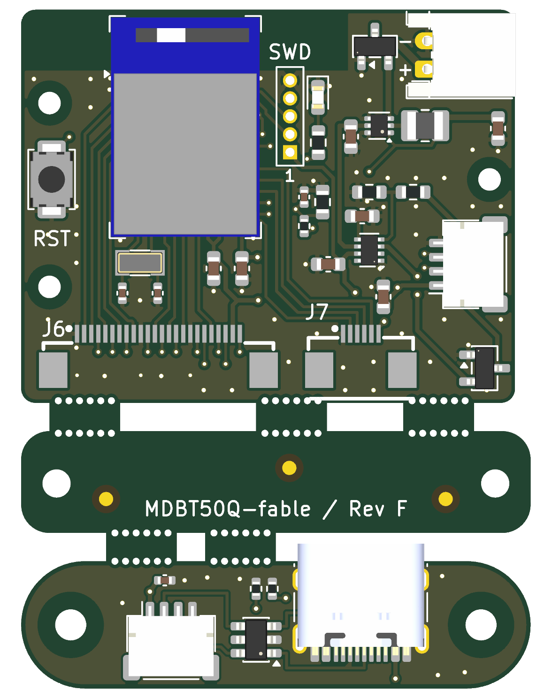

# MDBT50Q-board-fable — 変更点

`MDBT50Q-board-cdx`（Rev F）をコピーして作成した小型・本番向け版です。
元フォルダーのファイルは一切変更していません。KiCad 10 で `MDBT50Q-board-fable.kicad_pro` を開いてください。

- **Rev F（2026-11-22）**：MCU基板の電池コネクタ J8 を JST SH から **JST PH 2P（S2B-PH-K、cdx の J5 と同じ横型スルーホール）** に戻し、**右辺の上端**に移しました。MCU基板は幅 +1.8 mm（34.9 × 27.8 mm）。
- Rev E（2026-11-21）：電池基板をこの PCB（パネル）から外し、MCU基板と USB基板だけにしました。電池基板はキーボード基板と一緒に製造します。回路図には電池基板の部品を残しています（基板・BOM・CPL からは除外）。電池基板のレイアウトは `battery-board/` に単独の PCB として残しています。ファイル一式は `archive/revE/` に残しています。
- Rev D（2026-11-21）：電池基板に単4電池2本を直列（縦一列）で載せるように変更。電池コネクタ J5 をやめ、JLCPCB の SMD 電池クリップ C6937104（−）／C6937107（+）を2個ずつ実装。ファイル一式は `archive/revD/` に残しています。
- Rev C（2026-11-21）：電池まわり（J5/F1/SW2）を別の電池基板に分離し、MCU基板とは JST SH 2P のケーブルで接続。MCU基板は 33.1 × 27.8 mm に縮小。Rev C のファイルは保存していません（Rev D で上書き）。
- Rev B（2026-11-21）：MCU基板をさらに小型化し、固定穴を M1.4 に変更。ファイル一式は `archive/revB/` に残しています。
- Rev A（2026-11-16）：初版。ファイル一式は `archive/revA/` に残しています。

## Rev F：電池コネクタ J8 を PH に戻して右辺へ



### 部品と位置

| 項目 | Rev E | Rev F |
|---|---|---|
| J8（電池入力） | JST SH 2P 横型 SMD（SM02B-SRSS-TB）、上辺 x=26.1、開口は上向き | **JST PH 2P 横型スルーホール（S2B-PH-K）**、**右辺の上端**、開口は右向き |
| J8 のピン | — | 1番（BAT+）が下（y=4.2）、2番（GND）が上（y=2.2）。ピン列は x=28.7 |
| MCU基板外形 | 33.1 × 27.8 mm | **34.9 × 27.8 mm**（幅 +1.8 mm） |
| Q1（逆接続保護） | 右上角 (31.3, 2.6) | **J8 の左** (25.0, 2.6)（もとの J8 の場所） |
| C9 | (31.9, 7.6) | (33.7, 8.4)（右へ 1.8 mm、下へ 0.8 mm） |
| J2（USB基板行き SH 4P） | 右辺 (29.8, 18.0) | 右辺 (31.6, 18.0)（右辺に合わせて 1.8 mm 右へ） |
| U3（LDO） | (30.95, 25.35) | (32.75, 25.35)（右下角のまま） |
| H3（固定穴 M1.4） | (31.3, 12.0) | **(33.1, 12.0)**（右辺からの距離は同じ） |

- 座標は MCU基板の左上が原点です。左側（H1/H2、SW1、モジュール、J6/J7、J3）と昇圧回路（U4/L1/C10）は動かしていません。
- PH 横型は奥行き 8.7 mm × 幅 7 mm あり、今の右辺にはそのまま入りません。Q1 を J8 の左（アンテナ禁止領域のすぐ右）へ移せる最小の幅として、右辺を 1.8 mm 広げました。
- J8 の差し込み口の面は基板の右端とほぼ同じ位置です（0.1 mm 出ています）。ケーブルは右から差します。高さは S2B-PH-K の本体高さです。
- フットプリントは cdx の J5 と同じもの（`CDX_Connectors:..._EdgeSilk`）を元に、上辺と角に重なる本体外形のシルクを1本だけ除いた `fable_Parts:JST_PH_S2B-PH-K_1x02_P2.00mm_Horizontal_CornerSilk` を使っています（`tools/mkfp.py` で生成）。パッド・穴は同じです。
- 表面シルク：J8 のピンの左に `+`（1番）と `−`（2番）。裏面シルク：`J8: 1=BAT+ 2=GND`。
- パネルは 36 × 48 mm のまま（レールは USB基板の幅 36 mm）です。

### 配線

- MCU基板はスクリプトで再配線しました。電池入力は J8-1 → Q1 ドレイン（0.5 mm、約 3 mm）、Q1 ソース → U4/L1（0.4 mm）、L1 → C9（0.4 mm）です。
- 電池電圧の分圧（Q1 ソース → R3）と デバッグLED を USB D+/D− より先に配線するように順番を変えました。D+/D− も D+ を先に引いています。こうしないと、D+ が大回りして U5/C6 まわりの GND ベタが孤立していました。
- GND ビア 66 個（MCU基板）。

### 回路図

- J8 のフットプリントを上の PH に、説明を「JST PH 2P, S2B-PH-K (side entry, THT)」に変更しました。回路（ネット）は変えていません。
- 電池基板側の J9 は **SH 2P のまま**です（回路図の注記も「J9: JST SH 2P -> MCU board J8 (PH 2P)」）。J9 と J8 をつなぐケーブルは SH ↔ PH になります。

## Rev E：電池基板をパネルから外す

電池基板（113.3 × 14 mm）を同じパネルに載せるとパネルが 100 mm を超えるため、電池基板はキーボード基板と一緒に製造することにしました。この PCB は MCU基板と USB基板の2枚だけになります。

### PCB

- 電池基板の部品（BT1〜BT4、F1、SW2、J9、固定穴 H7/H8）、外形、マウスバイト、配線・ベタ・シルクをパネルから削除しました。
- レールの幅を USB基板と同じ 36 mm に戻しました。**パネルは 36 × 48 mm**（Rev B と同じ大きさ）です。
- MCU基板と USB基板の配置・配線は Rev D と同じです（スクリプトで作り直し、結果は同一）。MCU基板の電池入力は J8（SH 2P）のままです。
- シルクのリビジョン表記を Rev E に変更しました（レール・MCU基板裏面）。

### 回路図

- 電池基板の部品 BT1〜BT4・F1・SW2・J9 は回路図に残し、**「基板から除外」「BOM から除外」「位置ファイル（CPL）から除外」** にしました。この PCB の BOM・CPL には出ません。LCSC 番号などのフィールドは残しています。
- 電池基板の枠に「NOT on this PCB: made with the keyboard PCB」と注記を追加しました。回路（ネット）は変えていません。
- キーボード側の回路図へ移すときは、この枠の中をコピーし、上の3つの除外設定を戻してください。

### 電池基板の単独ファイル（`battery-board/`）

- `battery-board/MDBT50Q-battery.kicad_pcb`：Rev D の電池基板と同じ部品配置・配線・ベタ・シルクで、タブとレールをなくした単独の基板です（113.3 × 14 mm、左上が (50, 50) mm）。
- キーボード基板の PCB へ持っていくときは、このファイルを開いて全体を選択・コピーし、キーボード基板に貼り付けてください。ネット名（`BATT_GND`、`BATT_SW`、`/BATT_P`、`/CELL_MID`）は、キーボード側の回路図に合わせて付け直しが必要です。
- 設計ルールは本体の `.kicad_pro` と同じです。`fp-lib-table` で本体の `libraries/` を参照しています。
- `tools/battery_board.py` で作り直せます。DRC は違反0・未配線0です（回路図がないため、回路図との照合はしていません）。
- プレビュー：`battery-board/preview-top.png`、`battery-board/preview-bottom.png`。


## Rev D：単4電池2本を電池基板に直接実装

（電池基板の内容は Rev E でもそのままです。Rev E では、電池基板をこの PCB から外して `battery-board/` に単独で置いています。）

### 使う部品（MYOUNG、図面 WD-CP-0276 / -0277）

| 記号 | 部品 | LCSC | 役割 |
|---|---|---|---|
| BT1, BT3 | MY-AAA-19-J | C6937104 | − 側（バネ付き） |
| BT2, BT4 | MY-AAA-20-J | C6937107 | + 側（平板） |

- どちらも SMD・ニッケルめっきばね鋼 0.25 mm、JLCPCB では Extended 部品です。
- クリップ本体：電池方向 10 mm、幅 11 mm（±0.8）、高さ約 10.5 mm。電池をクリップでつかむ形なので、別のホルダーは不要です。
- 図面のランド：9 mm 以上（電池方向）× 5 mm 以上、1本分の −／+ ランドの内側どうしが 28 mm。フットプリントはランド 9.5 × 5.5 mm、中心間 37 mm で作りました（`libraries/fable_Parts.pretty`、`tools/mkfp.py`）。
- 原点はランド中心、Fab 層に本体の外形・接点板の位置・バネを描いています。3D モデルはありません。

### 回路図の変更

```
BATT_GND ─ BT1(−) [単4 #1] BT2(+) ─ CELL_MID ─ BT3(−) [単4 #2] BT4(+) ─ BATT_P → F1 → SW2 → J9-1
```

- J5（PH 2P）を削除し、クリップ4個を1ピンの部品（`Connector_Generic:Conn_01x01`）として追加しました。Value は `AAA-` / `AAA+`、LCSC・MPN・データシートのリンクも入れています。
- 電池そのもの（BAT1, BAT2、`Device:Battery_Cell`）は直列のつながりを示す図としてだけ置いています。BOM・基板には出ません。
- ネット名：電池1本目の + と2本目の − の間は `/CELL_MID`、電池の + 側から F1 までは `/BATT_P`（旧 `Net-(J5-Pin_1)`）。`BATT_GND` / `BATT_SW` と J9・MCU 側は変更なし。
- 電圧は Rev C の単3 × 2 と同じ 2 本直列（公称 3.0 V）なので、MCU 側の回路は変えていません。

### 電池基板（113.3 × 14 mm）

電池を長手方向に2本つなげて並べ、左端（MCU 基板側）にスイッチ類を集めました。座標は電池基板の左上が原点、電池の中心線は y=7.0 です。

| 部品 | 位置 |
|---|---|
| J9（MCU 基板行き SH 2P） | 左端 (3.3, 10.0)、開口は左向き。1番（BAT+）が上 |
| SW2（スライドSW） | 左上 (8.6, 2.9)、**レバーは上辺から出て左右に動く**。左＝ON、右＝OFF（Rev C と同じ向きの考え方） |
| F1（ヒューズ 1206） | (10.0, 9.0) |
| BT1（−）／BT2（+）：1本目 | x=19.0 ／ x=56.0 |
| BT3（−）／BT4（+）：2本目 | x=67.0 ／ x=104.0 |
| H7 / H8（固定穴 M1.4） | 左上 (2.0, 2.4)、右端 (111.3, 7.0) |

- 2本の電池はどちらも「左が −、右が +」の向きです。真ん中の BT2 と BT3 は背中合わせ（中心間 11 mm）で、表面の太いパターン（5 mm 幅）でつないでいます。
- 2本目の + （BT4）から F1 までは、裏面の 0.5 mm 線で基板の端から端まで戻しています。
- 表面のベタ（`BATT_GND`）は左端と BT1 のまわりだけにしています。クリップの足は基板にじかに触れるので、別のネットの銅箔をクリップの下に置かないためです。裏面は全面 `BATT_GND` のベタ、ビア 8 個で表裏をつないでいます。
- 表面シルク：電池2本の外形と `−` `AAA` `+`、SW2 の `ON` `OFF`。裏面シルク：基板名・`2x AAA ONLY  NO LiPo`・J9 のピン表。
- 電池をクリップに入れたときの高さは基板面から約 10.5 mm です。
- Rev C の電池基板の固定穴（H4/H5）は、USB 基板の H5 と記号が重なっていました。Rev D では H7/H8 に付け直しています。

### パネル

電池基板は Rev C と同じく MCU 基板の右に 2 mm あけて置き、下のレールにマウスバイト 4 か所でつないでいます。レールを右へ伸ばしたので、**パネルは 149.9 × 48 mm** になりました（Rev C は 49.8 × 48 mm）。100 mm を超えるため、基板代は Rev C より上がります。

## Rev C：電池基板の分離

（以下の電池基板の内容は Rev C 時点のものです。Rev D で単4クリップに置き換えました。）

### 回路図の変更（済）

電池ホルダーから昇圧回路までの経路を、SW2 の出力で2枚に分けました。USB 基板（J4 → J2）と同じ書き方で、基板ごとに別のネット名を付け、ケーブルでつなぐ形にしています。

```
電池基板: 電池 → J5 (PH 2P) → F1 → SW2 → J9 (SH 2P)
                                           │ ケーブル（2本）
MCU基板:                         J8 (SH 2P) → Q1（逆接続保護）→ 昇圧回路・電池電圧の分圧
```

| ピン | 電池基板 J9 | MCU基板 J8 |
|---|---|---|
| 1 | `BATT_SW`（SW2 の出力） | `VBAT_IN`（Q1 のドレイン） |
| 2 | `BATT_GND`（J5-2） | `GND` |

- J8・J9 のフットプリント：`Connector_JST:JST_SH_SM02B-SRSS-TB_1x02-1MP_P1.00mm_Horizontal`（横型 SMD、KiCad 標準ライブラリ）。ケーブルは **ピン1同士・ピン2同士をつなぐストレート**にしてください。
- J5 のピン2は、これまでの `GND` から電池基板側のネット `BATT_GND` に変わりました。
- Q1、電池電圧の分圧（R3/R4/C8）、昇圧回路は MCU 基板に残しています。ヒューズは電池のすぐ近くになり、基板間ケーブルのショートも保護範囲に入ります。
- 回路図上では、電池基板の部品（J5/F1/SW2/J9）を枠で囲んでいます。
- GND の PWR_FLAG は、J5 の横から J8 の GND に移しました（ERC 用）。
- J8・J9 には JLCPCB の部品番号（LCSC）をまだ入れていません。既存の J2/J4（SH 4P）と同じ扱いです。発注前に部品番号を確認して追加してください。
- ERC：違反0。ネットリストで、上の表どおりにつながっていることを確認しました。

### PCB（済）

パネルは「MCU基板・電池基板（上段） → レール → USB基板（下段）」の3枚構成になりました。電池基板は MCU基板の右に 2 mm あけて並べ、同じレールにマウスバイト（5 mm × 2か所）でつないでいます。

（Rev C のプレビューは保存していません。現在の `preview-top.png` は Rev F のものです。）

**MCU基板（33.1 × 27.8 mm、Rev B 比で幅 −2.9 mm）**

| 部品 | Rev B | Rev C |
|---|---|---|
| J5 / F1 / SW2 | 上辺右・右辺上 | **電池基板へ移動** |
| J8（電池入力 SH 2P、新規） | — | **上辺右寄り**（中心 x=26.1）。開口は上向き。1番ピン（BAT+）が右、2番（GND）が左 |
| Q1（逆接続保護） | SW2 の下 | 右上角（J8 の右） |
| 昇圧回路 U4/L1/C10 | y=10.6 の列 | 2.4 mm 上へ（J5 が空けた場所）。C9 は L1 の右に縦置き |
| R5 / R6 / C7（電源切替の周辺） | U5 の右 | U5 の上 |
| J2（USB基板行き SH 4P） | 右辺（中心 y=19.6） | 右辺（中心 **y=18.0**） |
| U3（LDO）/ C6 | 右下角 / J2 の左 | 右下角（変更なし）/ J2 の左（縦置き） |
| R7 | D1 の下（横置き） | D1 の下（縦置き） |
| H3（固定穴） | 右下角 (34.4, 25.5) | **右辺の中ほど (31.3, 12.0)** |

- H1 (2.0, 6.6)・H2 (2.0, 19.6) は変更なし。固定穴はすべて M1.4 用 NPTH Ø1.6、周囲 Ø3.2 は銅箔禁止です。
- J6/J7、モジュール、水晶、SW1、J3 の位置と、FPC 側の配線は Rev B と同じです。
- 座標は基板左上が原点です。

**電池基板（13.2 × 17.4 mm、新規）**

| 部品 | 位置（電池基板の左上が原点） |
|---|---|
| J5（電池 PH 2P） | 上辺、開口は上向き。1番（+）x=4.6、2番（−）x=2.6 |
| F1（ヒューズ 1206） | 右上 |
| SW2（スライドSW） | 右辺（中心 y=8.2）、レバーは右へ出る。**上側へ寄せると ON** |
| J9（MCU基板行き SH 2P） | 左辺（中心 y=11.2）、開口は左向き。1番（BAT+）が上 |
| H4 / H5（固定穴 M1.4） | 左下 (1.8, 15.6)、右下 (11.4, 15.6) |

- 配線は 0.5 mm 幅で手配置しています（J5+ → F1 → SW2 → J9-1、J5− → J9-2）。
- 両面に `BATT_GND` のベタを敷き、ビア 6 個で表裏をつないでいます。固定穴まわりの下の角はベタを抜いています（細い孤立銅が残らないように）。

**配線・シルク**

- MCU基板はスクリプトで再配線しました。電池入力は J8-1 → Q1 ドレイン（0.5 mm）、Q1 ソース → C9/L1（0.4 mm）です。
- USB 5V の入力コンデンサ C6 と J2-1 の間、電源切替の分圧（R5/R6 → U5）、C8/R4 の GND は手配置の線でつないでいます。
- 表面シルク：J8 の `−` `+`、電池基板の J5 の `−` `+`、SW2 の `ON` `OFF`。Rev B で入らなかった `OFF` 表示を電池基板では復活させました。
- 裏面シルク：MCU基板に J8 / SWD / J2・J4 のピン表、電池基板に「2xAA ONLY / NO LiPo」と J9 のピン表。

## 結果

| 項目 | cdx Rev F | fable Rev A | fable Rev B | fable Rev C | fable Rev D | fable Rev E | fable Rev F |
|---|---|---|---|---|---|---|---|
| MCU基板外形 | 55 × 40 mm | 40 × 28 mm | 36 × 27.8 mm | 33.1 × 27.8 mm | 33.1 × 27.8 mm（変更なし） | 33.1 × 27.8 mm（変更なし） | **34.9 × 27.8 mm** |
| 電池基板外形 | — | — | — | 13.2 × 17.4 mm（PH コネクタ） | **113.3 × 14 mm**（単4 × 2 直列） | **パネルから除外**（`battery-board/` に単独で 113.3 × 14 mm） | パネルから除外（変更なし） |
| 四隅 | — | R1.5 | R1.0 | R1.0（両基板） | R1.0（両基板） | R1.0 | R1.0 |
| USB基板外形 | 36 × 9 mm | 36 × 9 mm | 36 × 9 mm | 36 × 9 mm | 36 × 9 mm（変更なし） | 36 × 9 mm（変更なし） | 36 × 9 mm（変更なし） |
| パネル外形 | 55 × 60 mm | 40 × 48 mm | 36 × 48 mm | 49.8 × 48 mm | **149.9 × 48 mm** | **36 × 48 mm** | 36 × 48 mm |
| 層数／板厚 | 2層／1.2 mm | 2層／1.2 mm | 2層／1.2 mm | 2層／1.2 mm | 2層／1.2 mm | 2層／1.2 mm | 2層／1.2 mm |
| 部品実装面 | 表面 | 表面のみ | 表面のみ | 表面のみ | 表面のみ | 表面のみ | 表面のみ（J8 はスルーホール） |
| テストパッド | TP1〜TP20 | なし | なし | なし | なし | なし | なし |
| 固定穴 | M2 × 4 | M2 × 3 | M1.4 × 3 | M1.4 × 3 ＋ 2 | M1.4 × 3（MCU）＋ 2（電池：H7, H8） | M1.4 × 3（MCU） | M1.4 × 3（MCU、H3 を右へ 1.8 mm） |
| GND ビア | — | 92 | 64 | 59 ＋ 6 | 59（MCU）＋ 8（電池基板 `BATT_GND`） | 59（MCU） | 66（MCU） |

確認結果（KiCad 10.0.8 の kicad-cli、Rev F）:

- DRC：エラー0、警告0、未配線0、回路図との不一致0。
- ERC：違反0。
- 実機確認（通電・無線・USB・ケース合わせ）と、JLCPCBへの発注ファイル（Gerber／BOM／CPL）の出力は**未実施**です。

## Rev A → Rev B の変更

部品・定数・回路（ネット）は Rev A から変えていません。配置と外形だけを変えています。

### 外形・固定穴

- 外形：40 × 28 mm → **36 × 27.8 mm**。
  - 幅：右側の部品列（SW2/J2）を4 mm 内側へ寄せ、空いた角にあった M2 穴をなくしました。
  - 高さ：下辺を FPC コネクタ前面に 0.2 mm 近づけました。これ以上詰めると、マウスバイトの穴が J6/J7 の外形線（コートヤード）に入ります。
- 固定穴：**M1.4 用 NPTH Ø1.6 mm** を3か所。基板左上を原点とした座標で以下のとおりです。
  - H1 `(2.0, 6.6)`：左辺・上寄り
  - H2 `(2.0, 19.6)`：左辺・下寄り
  - H3 `(34.4, 25.5)`：右下角
  - 穴の周囲 Ø3.2 を両面とも銅箔禁止にしています。**ねじ頭／ワッシャーは外径 3.0 mm 以下**にしてください。
  - 右上角はスライドスイッチ SW2 が占めるため、穴を置いていません。
  - 左上の穴（H1）はアンテナ禁止領域から約 2.3 mm 下です。そこにはもともと GND ベタがあるため、金属ねじによるアンテナへの影響は GND ベタと同程度と見ています。

### 部品配置の変更

ケース設計に関わる位置です（座標は基板左上が原点）。

| 部品 | Rev A | Rev B |
|---|---|---|
| SW2（電源スライドSW） | 右辺 中央上（中心 y=9.7） | **右辺 最上部（中心 y=5.2）**。向きは同じ（上側が ON） |
| J2（USB基板行き SH 4P） | 右辺（中心 y=19.3） | 右辺（中心 y=19.6） |
| J5（電池 PH 2P） | 上辺（1番ピン x=28.45） | 上辺（1番ピン x=27.6） |
| SW1（リセット） | SW2 と J2 の間 | **左辺**（H1 と H2 の間、上から押す） |
| J6 / J7（FPC） | 下辺 | 下辺（位置・間隔 14.3 mm とも変更なし） |
| U3（LDO） | J2 の左 | 右下角（J7 の右） |
| F1 / Q1 | 上辺右／SW2 の左 | SW2 の下（右辺沿い） |
| J3（SWD） | x=19.5 | x=19.0 |
| D1 / R7（デバッグLED） | 横並び | D1 の下に R7 |

- J6/J7 の位置と、FPC のピン割り当て（Rev A で変更済み）は Rev B では変更していません。
- アンテナ禁止領域は、モジュール右端から 5.7 mm（Rev A 5.6 mm）の幅を確保しています。

### 配線

- すべてスクリプトで再配線しています。モジュール周りと FPC への引き出し（Rev A で詰めた部分）は Rev A と同じ経路です。
- RESET：SW1 を左辺へ移したため、SW1 → J3/モジュールの区間はモジュール直下の裏面を通しています。
- 電池経路：J5 → F1 → SW2 → Q1 の 0.5 mm 線は、SW2 の下を回り込みます。Q1 のドレイン線は F1 の2つのパッドの間（本体の下）を通ります。クリアランスは確保しており、電気的な問題はありません。
- USB D+/D−：J2 の横で裏面に落とし、モジュールの USB ピンまで裏面で配線しています（約 16〜20 mm）。

### シルク

- `OFF` 表示はスペースが無いため削除し、SW2 の上端に `ON` だけを残しました（スライダーを `ON` 側へ寄せると電源オン）。
- J5 の `+` `−` はピンのすぐ下に移動しました。`RST` は SW1 の下にあります。
- 裏面の凡例（SWD ピン配置、J2/J4 ピン配置、電池注意）は位置を調整して残しています。

## 回路図の変更（`MDBT50Q-board-fable.kicad_sch`）

Rev C の変更（電池基板の分離、リビジョン `fable-C`）は上の「Rev C」の節にまとめています。以下は Rev A で行った変更です。

### FPC のピン割り当て（Rev A で3ピン変更）

2層で交差なく引き出すため、モジュールのピン並びに合わせて入れ替えました。ファームウェアとFPCの相手側基板の修正が必要です。

| ピン | cdx | fable |
|---|---|---|
| J6-20 | P0.17 | **P1.09** |
| J7-3 | P1.09 | **P0.13** |
| J7-5 | P0.13 | **P0.17** |

J7 は `1=GND 2=P0.12 3=P0.13 4=P0.15 5=P0.17 6=3V3` になります。4本とも高速I/Oに使えるピンのままです。
J6 のほかのピンと、J2/J3/J5 のピン番号は変更していません。

### その他

- J3（SWD）：フットプリントを 2.54 mm ピッチから **1.27 mm ピッチ 1×5 スルーホール（未実装）** に変更。ブートローダー書き込み用として残しています。
- 回路の接続・部品定数はほかに変更していません。テストパッドは元々回路図に無く（PCBのみ）、PCBから削除しました。
- デバッグLED（P0.20 → R7 → D1）は状態表示に使えるため残しています。不要なら未実装にできます。
- 固定穴（H1〜H3）は回路図に無い PCB のみの部品です。

## cdx から直した点（Rev A で実施、Rev B でも維持）

1. **テストパッドの削除**：TP1〜TP12（MCU基板）、TP13〜TP20（USB基板裏面）と、そこへ伸びていた枝配線・ビアを削除。USB基板は裏面に銅パッドが無くなりました。
2. **USB D+/D− の枝配線**：測定用の分岐（スタブ）が無くなり、データ線が1本道になりました。
3. **昇圧回路（U4/L1/C9/C10）のループ**：出力コンデンサ C10 を U4 の VOUT/GND ピンの直近に置き直し、GND 戻りを直接結線。コンバータ直下の裏面には信号を通さず、GND ベタを連続させています。
4. **モジュール電源のデカップリング**：VDD（28/30番）→ C1、VBUS（32番）→ C2 をモジュール直下で最短接続。
5. **水晶まわり**：Y1/C4/C5 の裏面を信号禁止にし、負荷容量の GND を専用ビアで裏面ベタへ落としています。
6. **電源切替 U5**：180°回転し、電池側入力を昇圧側、USB側入力を LDO 側に向けました。同一ネットのピン（OUT 2/7、USB入力 3/5）は IC の下で結線しています。
7. **電池電圧の分圧（R3/R4/C8）**：SWD ヘッダーの下へ移動。
8. **GND**：両面ベタ＋ GND ビア（各 GND パッド近傍と約 2 mm 格子のステッチ）。FPC の GND ピン（J6-1/10/17、J7-1）はコネクタ本体下のビアで裏面へ接続。
9. **シルク**：文字高さを 0.8 mm → **1.0 mm**（JLCPCB の推奨最小）に変更。部品番号は密集のため F.Fab 層へ移しました。

## 配線ルール（JLCPCB 2層・1oz、2026-11-15 に公式ページで確認）

| 項目 | 本基板 | JLCPCB の下限 |
|---|---|---|
| 最小線幅 | 0.15 mm（4本のみ。ほかは 0.18 mm 以上、標準 0.2 mm） | 0.10 mm |
| 最小間隔 | 0.15 mm | 0.10 mm |
| ビア（信号） | 外径 0.5 / 穴 0.25 mm | 穴 0.25 は外径 0.45 以上なら追加費用なし |
| ビア（電源・GND） | 外径 0.6 / 穴 0.3 mm | — |
| 銅箔–基板端 | 0.3 mm 以上 | 0.2 mm |
| マウスバイト | 穴 0.5、穴間 0.25、タブ幅 5 mm、基板間隔 2 mm | 推奨値どおり |
| 固定穴 | NPTH Ø1.6 mm | NPTH 最小 0.5 mm |

- 0.15 mm を使っているのは P0.12 がモジュール角（33番と34番パッドの間）を抜ける部分だけです。0.18 mm は FPC コネクタ下の短い引き出しです。
- モジュール内側列のパッドは、モジュール下のビアで裏面へ落とし、FPC コネクタ本体の下で表面へ戻しています。

## これ以上小さくするには

MCU 基板は、同じ部品のままでは Rev C/D がほぼ限界です。
- 幅：下辺の J6 + J7（28.5 mm）と右下角の U3、右辺の J2（奥行き約 6.6 mm）で決まっています。
- 高さ：モジュール + FPC への引き出し + J6 で決まっています。

さらに詰める場合は、次のような部品・機構の変更が必要です（JLCPCB の部品番号も変わります）。
- 0603 の抵抗・コンデンサ・LED を 0402 に、ヒューズを 1206 から 0805 に変更する。
- J8 を縦型（上から差す）PH（B2B-PH-K）に、J2 を縦型 SH に変更する（ケースの高さが必要）。縦型 PH なら Rev E の幅 33.1 mm のまま右上角に入る見込みです（寸法からの見積もりで、配置は未検証）。
- J7 を下辺以外へ移す（ケース側の FPC 経路の変更が必要）。

## 発注前に確認してほしいこと

- **KiCad で目視確認**：配線はスクリプトで生成しています（DRC は通過）。気になる引き回しがあれば手で直せます。
- **ピン割り当ての変更**がキーボード側の設計と合うか。
- **J8 の位置（右辺上端、右から差す）と、ケースの右側にケーブルを出す空き**。
- **固定穴の位置（MCU 3か所、H3 は Rev F で右へ 1.8 mm。電池基板の 2か所はキーボード基板側で確認）とねじ頭径（3.0 mm 以下）**、SW2 の ON 方向、SW1 の位置、各コネクタの辺がケースと合うか。
- **電池クリップ**（電池基板をキーボード基板と一緒に発注するとき）：図面のランド寸法（中心間 37 mm）で作っています。電池を入れたときの高さ（約 10.5 mm）と、電池を出し入れする上方向のすき間がケースにあるか確認してください。クリップの向き（バネ側が −）は JLCPCB の実装プレビューで確認してください（3D モデルがないため、CPL の回転がずれることがあります）。
- **J9–J8 ケーブル**：Rev F から MCU基板側 J8 が PH 2P、電池基板側 J9 は SH 2P のままです。**SH ↔ PH のケーブル**で、ピン1同士・ピン2同士がつながるものが必要です。電池基板も PH にする場合は J9 の変更が必要です。
- **J8・J9 の部品番号（LCSC）**：まだ入れていません（J2/J4 と同じ扱い）。PCBA で実装する場合は BOM に追加してください。
- **PCBA の種別**：J8（PH 横型）はスルーホール部品なので、JLCPCB ではスルーホール実装（THT）の扱いになります（Rev B の J5 と同じ）。J3 は元と同じく実装対象外（未実装）。この PCB の BOM・CPL には電池基板の部品は出ません。電池基板（キーボード基板側で発注）は BT1〜BT4・SW2・F1・J9 すべて表面実装です。
- 3Dモデル：FPC コネクタと電池クリップはモデル未登録のため、プレビューに表示されません。

## ファイル

- `MDBT50Q-board-fable.kicad_pcb / .kicad_sch / .kicad_pro`：本体（Rev F。MCU基板・USB基板を1パネルに配置。回路図には電池基板も含む）
- `battery-board/`：電池基板（単4 × 2）の単独 PCB とプレビュー（Rev E で分離、内容は Rev D と同じ）
- `libraries/CDX_Connectors.pretty/PinHeader_1x05_P1.27mm_Vertical.kicad_mod`：J3 用に追加
- `libraries/fable_Parts.pretty/`：単4電池クリップ2種（Rev D）と J8 用 PH 2P（Rev F）のフットプリント（`fp-lib-table` に登録済み。`tools/mkfp.py` で生成）
- `preview-top.png`、`preview-bottom.png`：3D プレビュー（Rev F）
- `archive/revA/`：Rev A（40 × 28 mm）の PCB・回路図・スクリプト・プレビュー
- `archive/revB/`：Rev B（36 × 27.8 mm、電池部品が MCU 基板上）の PCB・回路図・スクリプト・プレビュー
- `archive/revD/`：Rev D（電池基板を含む 149.9 × 48 mm パネル）の PCB・回路図・スクリプト・プレビュー
- `archive/revE/`：Rev E（MCU基板 33.1 × 27.8 mm、J8 は SH 2P）の PCB・回路図・スクリプト・プレビュー
- `tools/`：再生成用スクリプト（電池基板の配線は `tools/battery.py`、単独の電池基板は `tools/battery_board.py`）。KiCad 付属の Python で `tools/run.py`（PCB）と `tools/sch_update.py`（回路図）を実行すると、cdx の元ファイルを読み取り専用で参照して作り直します。**KiCad 上で手修正したあとに `run.py` を実行すると上書きされる**ので注意してください。
